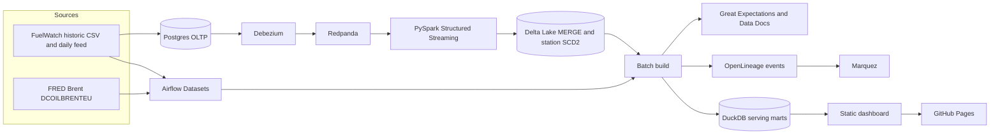

# Fuel Shock Radar

Live dashboard: [https://luciferdataengineer.github.io/fuel-shock-radar/](https://luciferdataengineer.github.io/fuel-shock-radar/)

Transport costs in Australia rose **8.7%** in the year to September 2026, and automotive fuel rose **23.6%**. Those figures are the Australian Bureau of Statistics consumer price index. This project asks what that shock looks like in Western Australia, using FuelWatch pump prices, FuelWatch terminal gate (wholesale) prices, and Brent crude.

The dashboard is for drivers and policy readers. It answers three questions and stops there.

1. **When should a Perth driver fill, and what is that worth?**
2. **How far is the pump price above wholesale, and do rises reach the pump faster than falls?**
3. **How much more does unleaded cost outside Perth?**

## Findings

Prices below are unleaded (ULP). Each station is counted equally. The extract runs from 1 October 2025 to 29 October 2026, plus the FuelWatch today/tomorrow board captured on 30 October 2026.

**Tuesday is the cheap day in Perth.** Over the 16 weeks to 29 October 2026 the average Perth price was **$2.04** on Tuesday and **$2.18** on Wednesday. That is a **13.5 cent** swing. On a 55 litre tank, filling on Tuesday instead of Wednesday saves **$7.44**. The swing is wide enough that timing the fill is worth planning. The price locked in for Saturday 31 October was **$2.28** in Perth.

**The pump price is tracking wholesale, not a fatter retail gap.** Over the last 7 days the Perth pump price sat **8.8 cents** above the Perth terminal gate price. The median gap across the year of daily prices was **7.6 cents**, so the current gap is in the usual range. Week by week, about **89%** of a wholesale rise and **91%** of a wholesale fall showed up in the pump price (27 rising weeks, 23 falling weeks). Rises and falls are reaching the pump at a similar rate. The level of prices is the shock: Perth unleaded in October 2026 was **37%** higher than October 2025, and Brent was **$123** a barrel on 27 October 2026, **88%** above a year earlier.

**Country towns pay more, and the Kimberley pays a lot more.** Over the 28 days to 29 October the average unleaded price outside Perth was **22 cents** higher than Perth ($2.56 against $2.34). Peel, which FuelWatch classifies as country, was closest to the city at $2.39. The Kimberley averaged **$3.03**.

| Decision | Figure | Status |
| --- | --- | --- |
| Cheapest day in Perth | Tuesday | High (the weekly swing is wide) |
| Saving from timing a 55 L fill | $7.44 | Elevated |
| Pump price above the Perth terminal price | 8.8c | Calm |
| Country premium versus Perth | 22c | Elevated |

Status cut-offs, and why the weekly pass-through throws away the Wednesday spike, are under [How the figures are calculated](#how-the-figures-are-calculated).

## Architecture

Historic files and the daily feed land in a curated extract. The same extract feeds the batch path (what CI runs) and can be loaded into Postgres, where Debezium publishes changes onto Redpanda for the Spark job.



The batch path does not start the streaming stack. It reads the curated parquet, checks it, rebuilds station history, writes DuckDB marts, and publishes `site/data/dashboard.json`.

## Tech stack

| Piece | Role |
| --- | --- |
| Postgres 16 | OLTP source for station and price changes, with logical replication |
| Debezium 2.7 | Change data capture from Postgres into Redpanda |
| Redpanda 24.3 | Kafka API log for the price and station topics |
| PySpark 3.5 Structured Streaming and Delta Lake 3.2 | `foreachBatch` MERGE into the price table, and SCD2 MERGE for station attributes |
| Airflow 2.10 Datasets | `fuel_shock_ingest` publishes a dataset; `fuel_shock_publish` is scheduled on it |
| OpenLineage and Marquez 0.51 | Run events for ingest, metrics, expectations, and the dashboard |
| Great Expectations 1.24 | Expectation suites and Data Docs |
| DuckDB 2 | Serving marts and the dashboard extract |
| GitHub Actions and GitHub Pages | Unit tests, the offline batch build, and the static site |

## Data sources and licences

| Source | What it is | Licence |
| --- | --- | --- |
| [FuelWatch historic fuel prices](https://catalogue.data.wa.gov.au/dataset/fuelwatch-historic-fuel-prices) | Daily retail prices. Files are listed at `https://www.fuelwatch.wa.gov.au/api/report/monthly-retail-prices` and downloaded from the FuelWatch historical-reports store. | [CC BY 4.0](https://creativecommons.org/licenses/by/4.0/). Custodian: FuelWatch, Department of Energy, Mines, Industry Regulation and Safety, Government of Western Australia. |
| [FuelWatch historic terminal gate prices](https://catalogue.data.wa.gov.au/dataset/fuelwatch-historic-terminal-gate-prices) | Daily wholesale prices. Catalogue at `https://www.fuelwatch.wa.gov.au/api/report/terminal-gate-prices`. | CC BY 4.0. Same custodian. |
| [FuelWatch daily feed](https://www.fuelwatch.wa.gov.au/api/sites?fuelType=ULP) | Today's and tomorrow's unleaded board, including the price locked in for the next day. | Published by FuelWatch for public use. Attribute FuelWatch as above. |
| [FRED DCOILBRENTEU](https://fred.stlouisfed.org/series/DCOILBRENTEU) | Europe Brent spot price, US dollars per barrel. The series is produced by the U.S. Energy Information Administration and republished by the Federal Reserve Bank of St. Louis. | FRED data is free to use with attribution. Cite FRED and the EIA. |
| [ABS CPI, September 2026](https://www.abs.gov.au/statistics/economy/price-indexes-and-inflation/consumer-price-index-australia/latest-release) | National context only: transport +8.7%, automotive fuel +23.6%, headline CPI +4.3%. These numbers are cited, not recomputed. | [CC BY 4.0](https://creativecommons.org/licenses/by/4.0/). Australian Bureau of Statistics. |

FuelWatch prices in the source files are cents per litre. The dashboard shows dollars per litre for price levels and cents for gaps.

## How to run

Python 3.11 or newer. The checked-in extract is enough for the dashboard, the tests, and the benchmark. Docker is only for the streaming stack.

```bash
make setup
make test
make batch
make benchmark
make site          # http://localhost:8080
```

`make data` refreshes the curated extract from FuelWatch and FRED. `make batch` rebuilds the dashboard from `data/curated` without downloading.

### Full streaming stack

```bash
make up
bash infra/debezium/register-connector.sh
bash scripts/load_oltp.sh
```

| Service | URL |
| --- | --- |
| Airflow | http://localhost:8080 (airflow / airflow) |
| Debezium Connect | http://localhost:8083 |
| Marquez | http://localhost:3000 |
| Redpanda | localhost:19092 |
| Postgres | localhost:5432 (fuelwatch / fuelwatch) |

Container passwords are for this local demo only. Postgres starts with `wal_level=logical` and a publication, `fuelwatch_pub`, on `station`, `retail_price`, and `terminal_gate_price`. Debezium unwraps the row (`ExtractNewRecordState`) onto topics `fuelwatch.public.retail_price` and `fuelwatch.public.station`. The Spark job merges price changes into a Delta table and applies SCD2 to station attributes: a change of brand, address, area, or region closes the open version and inserts a new one.

`make down` stops the stack.

### CI and GitHub Pages

`.github/workflows/ci.yml` installs `requirements.txt`, runs the unit tests, runs `python -m fuel_shock.batch --offline`, checks that `site/data/dashboard.json` matches that build, and smoke-tests the benchmark. It does not start Docker.

`.github/workflows/pages.yml` deploys the `site/` directory on every push to `main` with `actions/upload-pages-artifact` and `actions/deploy-pages`.

## How the figures are calculated

- **Perth week.** Daily mean of Perth unleaded, then the mean of those days by weekday, for the last 16 weeks (10 July 2026 to 29 October 2026). Across that window Tuesday was cheapest and Wednesday was dearest.
- **Tank saving.** `(dearest − cheapest) / 100 × 55` litres.
- **Wholesale gap.** Perth daily mean unleaded minus the mean unleaded terminal gate price at terminals whose location contains Kwinana or Kewdale. The card uses the last 7 days. The comparison line is the median daily gap over the whole extract.
- **Rises and falls.** Week-average pump and terminal prices, so the Wednesday retail spike is not treated as a wholesale response. A week counts when the terminal price moves by at least 0.5 cents. The reported share is the median of `pump change / terminal change`. The result is called symmetric when the rise share and the fall share differ by less than 10 percentage points.
- **Country premium.** Mean unleaded over the last 28 days for every station-day outside FuelWatch's Metro region, minus the Metro mean. Peel is country in FuelWatch's own region list, and it is shown separately on the chart.
- **Brent.** Latest observation against the observation on or before the same date a year earlier.
- **Station history.** Business key is trading name, suburb, and postcode. The batch rebuild in DuckDB and the Spark MERGE use the same rule. In this extract that is **1,044** stations, **1,109** versions, and **65** closed versions.

Status colours use fixed cut-offs:

| Figure | Calm | Elevated | High |
| --- | --- | --- | --- |
| Weekly swing | under 6c | 6c to under 12c | 12c or more |
| Tank saving | under $4 | $4 to under $8 | $8 or more |
| Gap over wholesale | under 1.5c above the past-year median | 1.5c to under 4c above it | 4c or more above it |
| Country premium | under 12c | 12c to under 25c | 25c or more |

## Data quality

Great Expectations 1.24 runs three suites during the batch build and writes Data Docs.

| Suite | Checks |
| --- | --- |
| Retail prices | Date, station, and price present. Price between 70c and 500c. Product is ULP, Diesel, or Brand Diesel. Region is one of the ten FuelWatch regions. Station, date, and product are unique together. |
| Terminal gate prices | Date and terminal present. Price between 40c and 400c. Product is in the same set. |
| Brent | Date present. Price between $5 and $250 a barrel. |

Data Docs are written to `quality/data_docs/index.html` (gitignored; regenerated by `make batch`). The build stops if a suite fails.

## Lineage

Each batch build writes OpenLineage run events under `lineage/events/`:

- `ingest.retail`, `ingest.wholesale`, `ingest.brent`, `ingest.daily_feed`
- `transform.metrics`
- `quality.expectations`
- `serve.dashboard`

If `MARQUEZ_URL` or `OPENLINEAGE_URL` is set (for example `http://localhost:5000`), the same events are posted to `/api/v1/lineage`. With `make up`, Marquez is at http://localhost:3000. The JSON files remain the copy that works when Marquez is down.

Airflow connects the same steps with Datasets. `fuel_shock_ingest` runs daily and publishes `file://fuel-shock-radar/data/curated`. `fuel_shock_publish` is scheduled on that dataset and rebuilds the dashboard.

## Benchmark

Serving question: once the extract exists, how should the dashboard aggregations run? Measured on the curated retail extract (**722,413** rows), median of 7 runs after one warmup. DuckDB times include reading the parquet file. Pandas times are the aggregation only, after DuckDB had already loaded the frame. The load itself took **98 ms**.

| Query | DuckDB, from parquet | Pandas, in memory |
| --- | --- | --- |
| Average Perth price by weekday | 3.5 ms | 7.8 ms |
| Daily Perth average | 3.3 ms | 1.5 ms |

DuckDB is the serving engine because the useful comparison is the whole step: read the extract and aggregate. That finishes in a few milliseconds. Pandas is quicker on one in-memory daily group-by, and slower on the weekday group-by, and it still needs the load. The Spark and Redpanda path is for change capture, not for these dashboard scans, so it is not in this table. Figures are from `benchmarks/latest.json`, regenerated with `make benchmark`.

## Repository map

```
src/fuel_shock/     ingest, metrics, SCD2, quality, lineage, batch, Spark job
airflow/dags/       Dataset-scheduled DAGs
infra/              Postgres init, Debezium connector, Marquez config
site/               dashboard
data/curated/       committed extract
tests/              unit tests and a fixture batch
```
