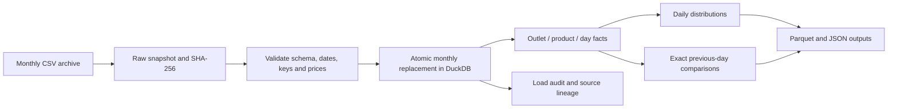

# Fuel Shock Radar

### A monthly retail-price warehouse with Python, DuckDB, and Parquet

[](https://github.com/LuciferDataEngineer/fuel-shock-radar/actions/workflows/ci.yml)


**Turn Western Australian fuel-price archives into a reproducible analytical data product.** Validate complete monthly snapshots, load a transactional DuckDB warehouse, calculate daily price distributions and matched-outlet changes in SQL, and export Parquet for further analysis.

This AI-assisted portfolio project demonstrates **ELT, analytical database design, data quality, temporal joins, and reproducible analysis**. It studies historical retail observations. It does not ingest wholesale or crude prices, establish causes of price changes, or provide live fuel availability.

## Why this topic

In September 2026, the WA government announced FuelWatch improvements focused on price transparency and discrepancy reporting. Trustworthy price data and clear comparison methods are a timely engineering problem. [WA Government announcement](https://www.wa.gov.au/government/announcements/fuelwatch-upgrades-and-emergency-fuel-powers-extended-support-wa-fuel-security)

A market average can move because different outlets appear in the data. This pipeline distinguishes that composition effect from a price change at the same reported outlet. It also handles corrected source files without duplicating facts or erasing unrelated months.

## Questions the warehouse supports

1. How do daily median prices and price distributions vary by fuel product and locality?
2. How much did a price change at the **same reported outlet** on consecutive calendar days?
3. Which observed changes cross an illustrative 10 cents-per-litre threshold?
4. Which source bytes, load, and monthly replacement produced a result?

“Shock” is the project name. A threshold flag identifies a numerical change, not an economic shock, causal finding, wrongdoing, or recommendation to buy fuel.

## Architecture



The pipeline ingests **completed calendar months only**. Current-month data is a moving partial snapshot and is rejected by this version. Every date in a source month must be represented, although that does not prove every outlet reported on every date.

## Implemented stack

| Layer | Technology | Why it is used |
|---|---|---|
| Acquisition | Python HTTP and CSV tools | Bounded batch downloads and explicit validation |
| Analytical database | DuckDB 2.0.0 | Transactions, decimal prices, analytical SQL, and Parquet support |
| Storage | DuckDB and Parquet | Local reproducibility and portable columnar extracts |
| Transformation | SQL joins, aggregates, and date logic | Inspectable grain and exact previous-day comparisons |
| Provenance | Raw files, SHA-256, load audit | Trace results and replay corrected snapshots |
| Verification | Python unittest | Offline tests of data contracts and analytical semantics |
| CI | GitHub Actions | Python 3.11 and 3.14 checks on every push |

No paid cloud account is required. Distributed streaming, CDC, Airflow, Spark, Delta Lake, and lineage servers are proposed extensions rather than implemented features.

## Source data and attribution

The WA open-data catalog lists **FuelWatch Historic Fuel Prices** under **Creative Commons Attribution 4.0**. It describes daily retail observations, with the current monthly file updated using the preceding day's data. Source dates are WA calendar dates. [Dataset catalog](https://catalogue.data.wa.gov.au/dataset/fuelwatch-historic-fuel-prices)

Live validation uses **September 2026**, retrieved on **30 October 2026**: 101,303 rows across 30 days. The download is historical, not a current price quote. The archive endpoint was located in a public client; the catalog-to-storage link could not be independently resolved from FuelWatch's JavaScript page in this environment. See [SOURCES.md](docs/SOURCES.md) for the exact endpoint, discovery chain, checksums, licensing evidence, and access limits. Raw live data is excluded from Git.

### Identity and units

The archive has no stable outlet identifier. A derived ID uses normalized trading name, address, locality, and postcode. Trading name is necessary because distinct reported offers can share an address. A rename creates a new identity; comparisons do not bridge it silently.

Counts describe **reported outlet identities**, not verified physical station counts. Purchase restrictions may be embedded in trading names; the data does not establish a person's eligibility for every offer. Prices are **cents per litre**, stored with one decimal place. Averages and medians are not weighted by sales volume.

## Reproduce the project

Requires Python 3.11 or newer:

```bash
git clone https://github.com/LuciferDataEngineer/fuel-shock-radar.git
cd fuel-shock-radar
python3 -m venv .venv
source .venv/bin/activate
python -m pip install .
python -m unittest discover -s tests -v
```

On Windows PowerShell, activate with `.venv\Scripts\Activate.ps1`. The [operations guide](docs/OPERATIONS.md) contains exact offline/live commands, replay steps, and failure recovery. Synthetic fixtures are fictional, reproducible, and require no network connection. [Examples](examples/) contain selected aggregate execution evidence.

Run the offline demonstration or download the completed September archive:

```bash
python -m fuel_radar ingest --data-dir demo-data --as-of 2026-10-30 \
  --file tests/fixtures/august_2026.csv --file tests/fixtures/september_2026.csv
python -m fuel_radar fetch --month 2026-09 --as-of 2026-10-30 --data-dir data
```

The warehouse is `data/warehouse.duckdb`. Read `data/exports/latest.json` to locate a complete generation of Parquet outputs and its summary.

## Engineering contracts

- One fact per reported outlet, product, and calendar date.
- A changed monthly source replaces only that month; other periods remain intact.
- Identical replay does not duplicate logical price facts.
- Invalid input cannot partially replace trusted facts.
- Day-on-day changes require the same outlet and product on the immediately preceding date. A gap is not a one-day change.
- Coverage and eligible comparison counts accompany summaries.
- Source checksums and execution history remain inspectable when inputs are corrected.

See [DATA_MODEL.md](docs/DATA_MODEL.md) for tables and metrics, and [analysis.sql](sql/analysis.sql) for analytical queries.

## Validation and operating limits

[VALIDATION.md](VALIDATION.md) records actual tests, live ingestion, replay, SQL execution, and Parquet reconciliation. The README badge reports remote CI separately from local checks.

| Verified on 30 October 2026 | Result |
|---|---:|
| Offline tests | 18 passed |
| September observations loaded | 101,303 |
| Fuel product labels | 7 |
| Parquet datasets reconciled against the warehouse | 4 of 4 |
| Business-state differences on identical replay | 0 |

Date coverage cannot prove every source record was supplied. Outlet identity, reporting coverage, and purchase eligibility affect interpretation. This implementation requires one writer and is not a hosted live dashboard.

## Explain it in an interview

- Why a median over changing samples differs from a matched-outlet change.
- Why LAG alone can accidentally compare across a missing date.
- How transactions and scoped replacement handle corrected or removed source rows.
- Why decimals, units, and declared grain prevent subtle errors.
- Why a derived outlet identity differs from a stable publisher key.
- When DuckDB and Parquet fit, and when concurrent usage needs another database.

## Repository map

```text
src/fuel_radar/       Acquisition, validation, warehouse and CLI
tests/               Synthetic fixtures and acceptance tests
sql/analysis.sql     Analytical queries
docs/                Sources, data model and operations
examples/            Dated aggregate execution evidence
.github/workflows/   CI checks
```

Original code is [MIT licensed](LICENSE). Data attribution: **Government of Western Australia, FuelWatch Historic Fuel Prices, CC BY 4.0**. Derived identifiers and transformations are this project's work. No government endorsement is implied.
